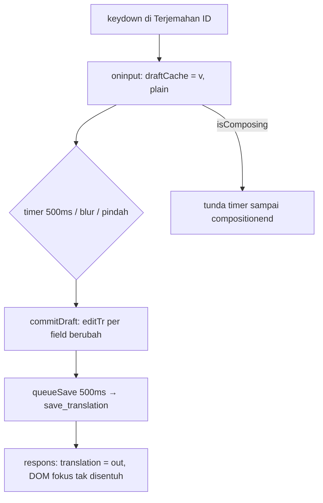

## Context

State hari ini (`kuron-studio/src/lib/EditorPanel.svelte`):

- Tiga textarea kartu (`original`/`reading`/`translated`) memakai `value={draft && draft.row === i ? draft.X : b.X}` satu arah + `oninput → draftInput` yang menulis `draft[field] = v` ke `$state` **per huruf**. Tiap keystroke = update reactive → Svelte evaluasi ulang `value=` ketiga textarea + derived (`selectedBubble`/`selectedRow`) + subtree `aside` (daftar bubble, `TranslatePanel`, tombol Save).
- Commit berlapis: `draftTimer` 500ms → `commitDraft` → `editTr` → `queueSave` 500ms → `saveTranslationEdits` → `api.saveTranslation` → respons `translation = out` (ganti seluruh objek) + `onSaved`. Mengetik terus = render besar tiap ~1 dtk tepat di tengah ketikan.
- Editor in-bubble (`CanvasEditor`, `bind:value` dua arah ke `editingValue` lokal, tak baca `translation` per huruf) **tidak terdampak** — delay hanya di kartu sidebar.
- Tanpa guard IME: `oninput` + `value=` satu arah beradu dengan komposisi browser (`isComposing`).
- Kontrak existing dipertahankan: `editTr` (tanpa yank), `commitDraft` via `editTr`, debounce 500+500ms, `saveGen` last-write-wins, badge `edited`, ↺ `resetBubble`, glossary long-press.

## Goals / Non-Goals

**Goals:**

- Huruf muncul di frame yang sama saat tombol ditekan (ketik = murni DOM browser, nol update reactive per huruf).
- Commit/autosave, badge, ↺, glossary, seleksi: perilaku sama persis dari sudut user.
- Aman IME (komposisi tak terpotong commit tengah jalan).
- Respons save / hasil Translate baru tak menimpa textarea yang sedang fokus.

**Non-Goals:**

- Ubah ritme autosave (500+500ms), kontrak invoke, backend Rust, baseline `ai*`, `saveGen` guard.
- Ubah editor in-bubble. Virtualisasi daftar / rewrite `aside`. After-true / ROb.

## Decisions

### D1 — Textarea uncontrolled + cache plain non-reactive

`draftInput` tidak lagi menulis `$state` per huruf. Ketikan ditampung di `draftCache` biasa (plain object, bukan `$state`) + timer debounce yang juga tak menyentuh state. `value=` di markup hanya membaca `draftShown` (`$state` snapshot yang diperbarui **hanya** saat: ganti bubble, commit, sinkronisasi eksternal) — selama mengetik, Svelte tidak mengevaluasi ulang textarea karena tak ada dependensi reactive yang berubah → DOM `value` milik browser penuh, kursor dan komposisi stabil.

```
sebelum:  keydown → oninput → draft[field]=v ($state!)
                               → re-render aside + value= dievaluasi ulang
sesudah:  keydown → oninput → draftCache[field]=v (plain, tanpa render)
                               → timer 500ms → commitDraft → editTr (sekali)
```

Alternatif ditolak: (a) `bind:value` dua arah — tetap update `$state` per huruf, masalah sama; (b) remount textarea per keystroke (`{#key}`) — menghancurkan fokus tiap huruf; (c) throttle `draftInput` — menunda huruf tampil, menukar delay render dengan delay tampil.

### D2 — Jalur commit dipakai ulang utuh

`commitDraft` membaca `draftCache`, memanggil `editTr(row, field, v)` per field berubah (guard `!==` existing), lalu membersihkan cache + snapshot. `selectBubble`, `saveTranslationEdits`, `onTranslated` yang hari ini memanggil `if (draft) commitDraft()` diganti cek cache (`if (draftCache)`). Ritme, badge, save, guard generasi: nol perubahan.

### D3 — Aturan sinkronisasi eksternal (matriks)

`draftShown`/DOM hanya ditulis ulang di luar ketikan, dengan aturan:

| Peristiwa | Saat fokus mengetik di kartu | Saat tidak fokus |
|---|---|---|
| Ganti bubble (`selectBubble`) | commit cache dulu, lalu snapshot baris baru | snapshot baris baru |
| Hasil Translate baru (`onTranslated`) | commit cache dulu (existing), merge lindungi edited | merge existing |
| Respons save (`translation = out`) | isi respons == hasil commit (tak ada beda visual); jangan sentuh DOM | `value=` baca `b.X` baru seperti biasa |
| ↺ `resetBubble` | klik ↺ didahului blur → commit dulu (urutan browser), lalu tulis `ai*` + snapshot ulang | tulis `ai*` + snapshot ulang |

Kunci: respons save tidak pernah menulis DOM textarea yang fokus — karena isinya identik dengan yang diketik, dan `value=` tidak dievaluasi ulang tanpa perubahan dependensi.

### D4 — Guard IME composition

`oncompositionstart` → flag `composing=true` + bersihkan `draftTimer` (jangan commit tengah komposisi). `oninput` saat composing tetap menampung cache tapi tak me-restart commit. `oncompositionend` → `composing=false`, restart timer 500ms (atau commit langsung bila timer konsisten dengan ritme existing — pilih restart timer agar ritme seragam). `commitDraft`/`commitEditor`-setara menolak jalan saat `composing`.

### D5 — Tanpa backend, tanpa kontrak invoke

Nol perubahan `src-tauri/`, nol command baru, nol perubahan L1/L2. `save_translation` tetap dipanggil dengan bentuk sama.



## Risks / Trade-offs

- **Drift DOM-vs-state**: DOM kini sumber kebenaran sementara. Bila `translation` diganti dari luar dengan teks berbeda saat fokus (Translate baru masuk, ↺ diklik via keyboard tanpa blur), textarea tak ikut — sesuai D3 (draft menang, konsisten dengan `mergeUserEdits`/edited-guard), tapi perlu E2E eksplisit per sel matriks.
- **Test buta latensi**: pola-sumber (`?raw`) hanya bisa assert "tanpa write reactive per huruf", bukan milidetik. Bukti = E2E manual terukur (kriteria di tasks). Ceiling: ukur frame via DevTools bila perlu.
- **`value=` + snapshot basi**: bila snapshot tak dibersihkan saat commit, kartu menampilkan teks lama setelah save. Aturan: commit selalu sinkronkan/bersihkan snapshot searah (cache kosong → `value=` baca `b.X` yang sudah == hasil commit).
- **Aksesibilitas**: uncontrolled textarea tetap terbaca screen reader (label `<p>` existing tak berubah); commit-on-blur dipertahankan.

## Reuse map Kuron -> Studio

Nol reuse baru — murni frontend Svelte. Dipakai ulang utuh: `editTr`, `queueSaveTranslationEdits`, `saveTranslationEdits` + `saveGen` guard, `mergeUserEdits`, `selectBubble`, `resetBubble`, kontrak test `edit-stuck.test.ts` (diperbarui, bukan dihapus).
