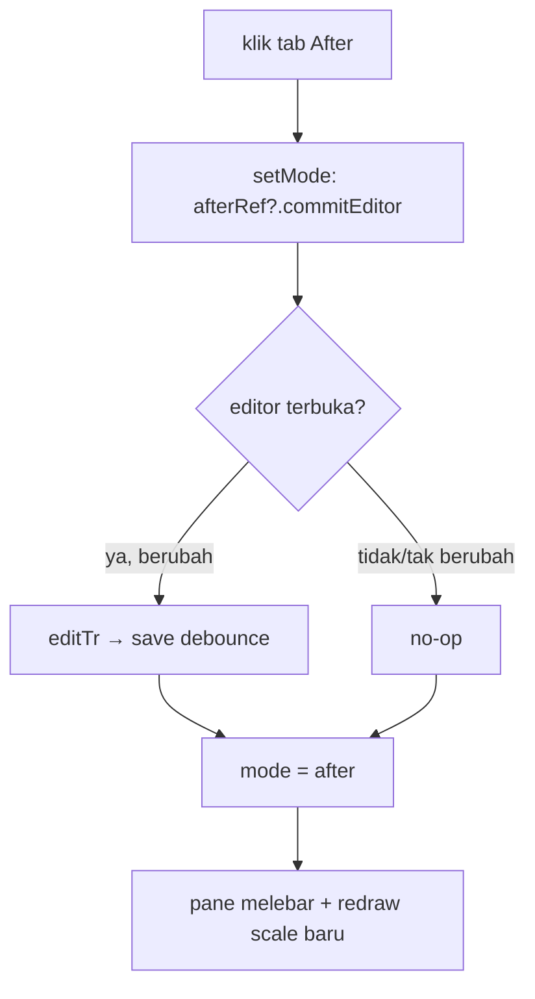

## Context

State hari ini (`kuron-studio/src/lib/`):

- `EditorPanel.svelte` punya `mode: 'before'|'split'|'after'` + switcher. Pane dirender via `{#if}`: Split→After **tidak me-remount** instance After (kondisi `mode === "after" || mode === "split"` tetap true) — instance yang sama hidup terus, tapi lebar holder berubah ~½ → penuh.
- `CanvasEditor.svelte`: `openEditor(i)` snapshot `editBox` (posisi textarea HTML) sekali dari `scale()` saat itu; tak pernah dihitung ulang. `redraw()` baca `scale()` fresh tapi hanya dipicu perubahan `translations`/`showTranslation`/`externalSelected` — ganti tab tak memicu. Nol `ResizeObserver` di seluruh `src/`.
- Fix commit-yank sebelumnya: `editTr` tak lagi sentuh `manualSel` (seleksi hanya via `selectBubble`); `openEditor` kunci seleksi baru dulu; `commitEditor` skip bila tak berubah.
- Instance After hari ini **tidak di-bind** (`editorRef` hanya milik Before untuk `deleteSelected`).

Keputusan explore yang dikunci user: editor tidak boleh tetap terbuka saat ganti tab — **commit otomatis** (ketikan selamat via jalur existing).

## Goals / Non-Goals

**Goals:**

- Ganti tab selalu mulai dari state bersih: tak ada textarea basi, tak ada canvas ber-scale lama.
- Ketikan yang sedang berjalan selamat (commit, bukan cancel).
- Tanpa backend baru, tanpa ubah kontrak invoke, tanpa ubah ritme autosave.

**Non-Goals:**

- After-true (PNG typeset); reposisi textarea live via `ResizeObserver` (ponytail bila commit-cukup diprotes); editor di Before.

## Decisions

### D1 — Commit-on-switch, bukan reactive-resize

Ganti `mode` → panggil `commitEditor()` di instance After sebelum/saat pane berganti. Dipilih karena: 1–2 baris + satu `bind:this`, menutup lapis 2 (textarea) dan lapis 3 (redraw tertunda memecah konsistensi) secara konstruksi — editor tak pernah terbuka saat lebar berubah. Alternatif reaktif (ROb → redraw + reposisi `editBox` + font) ditolak untuk sekarang: perlu guard drag/drawing, throttle anti-thrash, hitung ulang font, risiko loop scrollbar — biaya besar untuk kasus yang keputusan UX-nya memang "tutup saat ganti tab".

### D2 — Bind `afterRef` terpisah, panggil fungsi yang di-export

`CanvasEditor` expose `commitEditor` sebagai `export function` (pola sama seperti `deleteSelected`/`setTailForSelected` yang sudah di-export untuk Before). `EditorPanel` tambah `let afterRef = $state<{ commitEditor: () => void } | null>(null)` + `bind:this={afterRef}` pada instance After. Handler ganti tab: `function setMode(m) { afterRef?.commitEditor(); mode = m; }`, switcher memanggil `setMode`.

Alternatif (effect `$effect(() => { mode; afterRef?.commitEditor(); })`) ditolak: effect jalan *setelah* render — terlambat satu frame, textarea basi sempat tampil; pemanggilan eksplisit di handler synchronous sebelum `mode` berubah.

### D3 — Commit memakai guard tak-berubah yang sudah ada

`commitEditor` sudah skip `onEditTranslation` bila `editingValue === cur` (fix sebelumnya) — jadi setMode saat editor tak terbuka atau teks tak berubah = no-op murah, tanpa save sia-sia, tanpa badge `edited` palsu.

### D4 — Redraw pasca-switch via rAF (diputuskan saat apply: keluhan "gak full")

`setMode` redraw kedua pane (`editorRef` + `afterRef`) di `requestAnimationFrame` setelah `mode = m` — layout sudah settle, `holder.clientWidth` sudah lebar baru (sync = baca lebar lama). `redraw()` di-export + sinkronkan `bgImage.size()` agar background dan overlay satu scale (tanpa ini: split-brain — gambar diam, bubble pindah). Dipilih A1 (redraw eksplisit sekali) atas A2 (`ResizeObserver`): murah, tanpa guard thrash/drag/loop-scrollbar; ROb tetap ponytail bila resize-window diprotes.

## Risks / Trade-offs

- **Dua ref, dua lifecycle**: `editorRef` (Before) vs `afterRef` (After) — jangan tertukar; `deleteSelected` tetap milik Before.
- **Commit memicu save → respons async**: `translation = out` datang belakangan via `saveGen` guard existing (fix-edit-stuck §4) — aman.
- **Test pola-sumber tak membuktikan posisi nyata** — E2E manual wajib (skenario di tasks).
- **Canvas scale-lama-bila-tak-ada-ketikan** (D4) — gejala sisa ringan, sadar.

## Reuse map Kuron -> Studio

Tidak ada reuse Kuron App baru — murni frontend Svelte (`EditorPanel`/`CanvasEditor`), tanpa perubahan Rust. Jalur dipakai ulang utuh: `editTr` → debounce 500ms → `save_translation` → `saveGen` guard.
