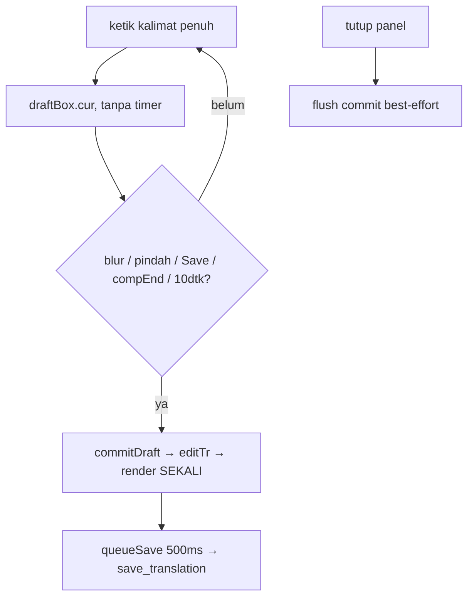

## Context

State hari ini (`kuron-studio/src/lib/EditorPanel.svelte`, pasca `fix-card-input-lag`):

- `draftInput` menulis `draftBox.cur` plain (nol `$state` per huruf) + antre `draftTimer` 500ms → `commitDraft` → `editTr` → `translation.bubbles = .map()` (render kartu) → `queueSave` 500ms → `save_translation`.
- 1 kalimat = N jeda mikro = N commit = N render tengah-ketik. Cache menghilangkan render-per-huruf, tapi render-per-commit tetap — dan commit di tengah kalimat = kursor goyang + frame ketik tertabrak.
- Kontrak dipertahankan: `editTr` (tanpa yank), `commitDraft` via `editTr`, `saveGen` last-write-wins, `mergeUserEdits`, badge `edited`, ↺ `resetBubble`, glossary long-press, guard IME `composing`.
- User memilih kenyamanan atas crash-safety: V2' (commit on blur/pindah/Save/compositionend + timer-jaring 10 dtk).

## Goals / Non-Goals

**Goals:**

- Nol commit/render selama mengetik — kalimat sepanjang apa pun selesai tanpa interupsi.
- Autosave tetap sebagai jaring (fire pasca-commit), bukan ritme kerja.
- Indikator dirty jujur: user tahu kapan ada yang belum tersimpan.
- Flush best-effort saat panel ditutup/unmount.

**Non-Goals:**

- Hapus autosave total. Ubah backend/invoke/baseline/guard. Ubah in-bubble. Virtualisasi. After-true/ROb.

## Decisions

### D1 — Hapus `draftTimer` 500ms; commit hanya blur/pindah/Save/compositionend/jaring

`draftInput` hanya menulis cache + (bila tak composing) tidak antre apa pun. Titik commit: `onblur` textarea (existing), `selectBubble`/`setMode`/tutup-panel (existing `if (draftBox.cur)`), tombol Save (baru: `commitDraft` + `saveTranslationEdits` langsung), `compEnd` (existing, timer diganti commit-tertunda → lihat D2), timer-jaring 10 dtk (baru, D3).

Alternatif ditolak: V1 (timer 2-3 dtk) — kalimat panjang/pengetik lambat masih kena, bug "kadang terjadi" tak terverifikasi sembuh; V3 (hapus autosave) — beban ingat-save ke user + lupa-save lebih mahal dari crash-sebelum-blur.

### D2 — `compEnd` commit langsung (bukan timer)

Komposisi IME selesai = batas kata alami → commit langsung, bukan antre 500ms. Konsisten dengan "commit di batas alami, bukan batas waktu". Guard `composing` di `commitDraft` tetap (tolak commit tengah komposisi dari jalur lain: blur tengah-komposisi? browser urutkan compositionend-dulu — aman, tapi guard ganda tak ada rugi).

### D3 — Timer-jaring 10 dtk sebagai pengaman, bukan ritme

Satu timer per baris kotor: fire → `commitDraft` (+ save via `queueSave` existing). Praktis tak pernah fire saat ketik normal (blur/pindah jauh < 10 dtk); menyelamatkan sesi ditinggal tanpa blur + crash/lupa. Kalimat >10 dtk = 1 commit tengah (bukan N) — diterima. Konstanta bernama (`DRAFT_SAFETY_MS = 10_000`) agar niat terbaca, bukan angka ajaib.

### D4 — Indikator dirty + Save sebagai flush eksplisit

Tombol Save existing (`saveTranslationEdits`, disabled saat `savingTr`) ditambah: label/indikator saat cache kotor (mis. titik/badge "belum tersimpan" — bentuk visual ikut konvensi `dirty` bubble yang sudah ada: `Simpan*` vs `Tersimpan`). Handler Save: `commitDraft()` dulu lalu `saveTranslationEdits()` (yang juga commit-dulu — idempoten, aman ganda). Indikator dihitung dari `draftBox.cur !== null`… plain (tak reactive!) → perlu sinyal reactive murah: `dirtyDraft = $state(false)` set true di `draftInput`, false di `commitDraft`/reset/select-null. Satu boolean per panel (bukan per huruf — write `$state` sekali per *mulai-rangkaian-ketik*, bukan per huruf; render 1× per fokus, bukan N× per huruf).

### D5 — Flush best-effort saat tutup/unmount

`onDestroy` existing membersihkan timer → tambah `if (draftBox.cur) commitDraft()` SEBELUM clear (commit sinkron menulis `translation.bubbles` + antre save; save 500ms fire-and-forget — kill paksa <500ms tetap hilang, diterima). Tutup panel (`onClose` App-level me-remount via `{#key}` → destroy) ikut jalur ini otomatis.

### D6 — Sync-guard: tunda timpa prop saat kotor/terbang (opsi C audit)

Hasil audit: satu-satunya pelaku overwrite-tengah-ketik = cabang `translation` di `syncFromPage` (L140-142) yang menimpa state lebih baru dengan prop basi di jendela commit→save. Opsi A mentah (tak pernah sync saat id sama) ditolak: regresi hasil batch/retry yang masuk via `refreshProject` + `syncFromPage` (BatchPanel `onDone → refreshProject`; ReviewGrid retry → `onRefresh`; progress events tak menyentuh state — aman). Opsi A-generasi (cap lokal) diparkir ponytail.

Aturan: cabang `translation` di-skip bila `draftBox.cur !== null` (ketikan kotor) ATAU save terbang (`saveTimer !== null || savingTr`). Cabang `bubbles` (geometri) tak diubah — pelaku cabang translation; penulis `bubbles` (Detect/Save manual) bukan ketik-kontinu. Saat kondisi tenang (tak kotor + tak terbang), sync jalan normal: echo, mount, batch, retry semua lolos. Kabar batch yang tiba saat mengetik = tertunda sampai berhenti sejenak (bukan hilang). Audit: Review overlay terpisah (tak balapan ketikan); batch-progress lokal panel (tak sentuh ①/②); satu-satunya overlap nyata = batch-done-refresh vs ketik — ditutup guard ini.

### D7 — Tanpa backend, tanpa kontrak invoke

## Risks / Trade-offs

- **Crash/kill <10 dtk setelah ketik tanpa blur**: hilang. Diterima user; di bawah status quo (500ms) tapi harga kenyamanan.
- **Overlay After + badge tertunda** sampai batas alami — teks bubble tak live-update saat mengetik. Diterima.
- **`dirtyDraft` boolean = 1 render per mulai-ketik**: masih jauh di bawah N-render-per-huruf; bukan regresi.
- **Timer-jaring vs kalimat 10 dtk+**: 1 commit tengah — E2E harus mencakup skenario ini agar ekspektasi jujur.
- **Test buta latensi**: pola-sumber assert struktur (tanpa timer-500ms, ada jaring/indikator), bukti = E2E terukur.

## Reuse map Kuron -> Studio

Nol reuse baru — murni frontend Svelte. Dipakai ulang utuh: `editTr`, `commitDraft` (tanpa timer), `queueSaveTranslationEdits`, `saveTranslationEdits` + `saveGen`, `mergeUserEdits`, `selectBubble`, `resetBubble`, guard IME, kontrak `edit-stuck.test.ts` (diperbarui).
